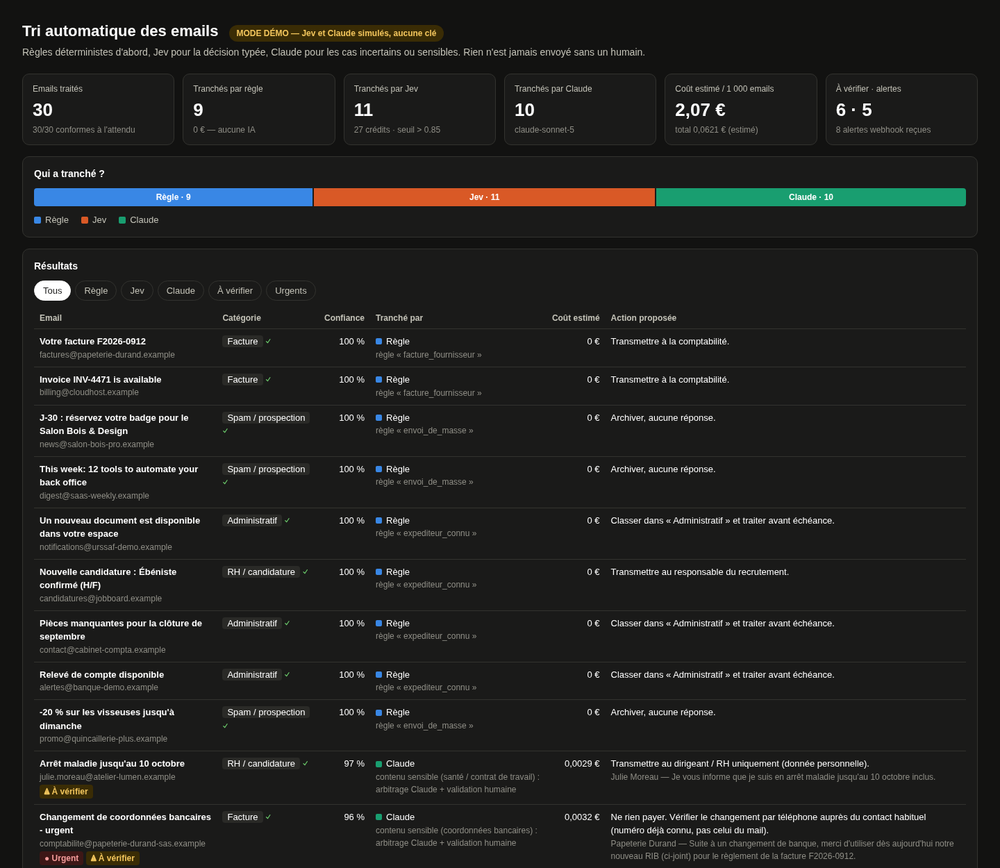
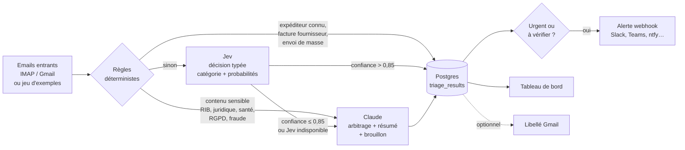

# Tri automatique des emails d'une PME — n8n + Jev + Claude

[](https://github.com/Mr-yums/n8n-email-triage/actions/workflows/ci.yml)


> Démo de l'offre freelance **« Automatiser un processus métier en 5 jours »**.
> Lancement en une commande, **mode démo sans aucune clé**, données 100 % fictives.
> *English summary at the end.*



## Le problème

Une PME reçoit chaque jour des dizaines d'emails mélangés : factures, demandes de devis, clients qui ont un souci, candidatures, courrier administratif, prospection… Quelqu'un les lit un par un pour savoir quoi en faire. C'est lent, des urgences passent à la trappe, et les arnaques (faux changement de RIB, fraude au président) arrivent au milieu du reste.

Envoyer chaque email à un grand modèle d'IA résout le tri, mais coûte cher à l'échelle et confie à une IA des décisions qui doivent rester humaines.

## La solution : du moins cher au plus cher, et un humain pour envoyer



1. **Règles déterministes** (gratuites, explicables) : expéditeurs connus (adresses exactes), factures de fournisseurs connus avec PDF, envois de masse (`List-Unsubscribe`). Un contenu **sensible** n'est jamais tranché par règle : il part directement chez Claude et chez un humain.
2. **[Jev](https://iajev.com)** : décision typée bon marché via son API REST (`POST /api/v1/decisions/run`) — une catégorie parmi 7 avec probabilités, puis l'urgence. Voie directe **seulement si la confiance est strictement supérieure au seuil** (0,85 par défaut).
3. **Claude** (API Messages d'Anthropic, `claude-sonnet-5` par défaut, `claude-opus-5-5` en option) : tranche les cas incertains ou sensibles avec tout le contexte, rédige un résumé, propose une action et un **brouillon de réponse** pour les devis et le support. Sortie JSON contrainte par schéma (`output_config.format`), effort réglable.
4. **Sortie** : table Postgres (+ vue `triage_summary`), alerte webhook pour « urgent » ou « à vérifier », libellé Gmail optionnel, tableau de bord.

**Le projet ne répond jamais seul.** Les brouillons sont stockés, jamais envoyés ; tout cas sensible est marqué « à vérifier » par un garde-fou indépendant du modèle.

Catégories : facture · devis / demande commerciale · support client · RH / candidature · administratif · spam / prospection · autre.

## Démarrage en 3 commandes

Prérequis : Docker avec Compose v2.

```bash
git clone https://github.com/Mr-yums/n8n-email-triage.git
cd n8n-email-triage
docker compose up --build
```

- Le premier lancement compile la passerelle Rust (≈ 4 min) ; les suivants démarrent en quelques secondes.
- Le service `demo-seed` envoie les 30 emails d'exemple au workflow n8n, attend la fin et affiche le bilan.
- **Tableau de bord** : <http://localhost:18090> — **n8n** (workflow importé et publié automatiquement) : <http://localhost:15678> (n8n demande de créer un compte local à la première visite).
- Repartir de zéro : `docker compose down -v`.

Ports modifiables via `DASHBOARD_PORT` et `N8N_PORT` ; tout est publié sur `127.0.0.1` uniquement.

## Résultat (mode démo)

Mesure sur le jeu d'exemples (30 emails FR/EN fictifs), identique en mémoire (`eval`) et via le workflow n8n réel :

| Tranché par | Emails | Part | Coût estimé |
|---|---:|---:|---:|
| Règles | 9 | 30 % | 0 € |
| Jev | 11 | 37 % | 0,025 € (22 crédits) |
| Claude (`claude-sonnet-5`, effort `low`) | 10 | 33 % | 0,037 € |
| **Total** | **30** | | **0,062 € ≈ 2,07 € / 1 000 emails** |
| *Référence : tout envoyé à Claude* | | | *≈ 3,04 € / 1 000 emails* |

- 30/30 catégories conformes à l'attendu, 6 emails marqués « à vérifier », 5 urgents, 8 alertes envoyées.
- Hypothèses de coût : Jev Starter 16,90 € / 15 000 crédits (1 crédit par tranche de 1 000 tokens d'entrée, 2 appels quand Jev garde la main : catégorie puis urgence) ; Claude Sonnet 5 à 2 $ / 10 $ par million de tokens, 1 $ = 0,86 € ; tokens estimés à 4 caractères par token.

**À lire honnêtement :**

- En mode démo, **Jev et Claude sont simulés** par des heuristiques déterministes calibrées sur ce jeu d'exemples. Le 30/30 prouve que la mécanique (routage, seuil, garde-fous, alertes, stockage) fonctionne, **pas** la qualité réelle des modèles. Pour la mesurer : `TRIAGE_MODE=live` sur un échantillon étiqueté de la PME (voir plus bas).
- L'essentiel de l'économie vient des **règles**. À ce volume de texte, deux appels Jev (≈ 0,0023 €) coûtent à peine moins qu'un appel Sonnet 5 en effort bas (≈ 0,003 à 0,0045 €, estimé). Leviers si le coût compte : un seul appel Jev (urgence laissée aux règles), plus de règles métier, ou le seuil ajusté après mesure.
- Le prompt système porte un `cache_control`, mais il fait ≈ 650 tokens, sous le minimum de mise en cache de Sonnet 5 (1 024) : il ne sera mis en cache que si vous l'enrichissez (exemples propres à la PME, par exemple).

## Configuration réelle

Copiez `.env.example` en `.env` (jamais versionné) et remplissez :

| Variable | Rôle |
|---|---|
| `TRIAGE_MODE` | `demo` (défaut) ou `live` (appels facturés) |
| `JEV_API_KEY` | clé Jev (iajev.com) |
| `JEV_CONFIDENCE_THRESHOLD` | seuil de la voie directe Jev (défaut 0,85, strictement supérieur) |
| `ANTHROPIC_API_KEY` | clé de l'API Claude |
| `CLAUDE_MODEL` | `claude-sonnet-5` (défaut) ou `claude-opus-5-5` |
| `CLAUDE_EFFORT` | `low` (défaut), `medium`, `high` |
| `ALERT_WEBHOOK_URL` | webhook d'alerte (Slack, Teams, ntfy, autre workflow n8n…) |
| `POSTGRES_PASSWORD` | mot de passe de la base (à changer hors démo) |

Les clés ne sont lues **que par la passerelle** : n8n ne les voit jamais.

**Boîte mail.** Dans n8n, ouvrez le workflow, ajoutez un identifiant IMAP sur le nœud « Boîte mail IMAP (à configurer) » (pour Gmail : IMAP activé et mot de passe d'application) puis activez le nœud. Le nœud « Gmail : appliquer le libellé » est fourni désactivé ; il demande un identifiant Gmail OAuth.

**Règles.** `config/rules.json` (monté en lecture seule, modifiable sans recompiler) : expéditeurs connus, fournisseurs dont les factures PDF sont classées d'office, motifs sensibles.

**Mesurer la qualité réelle avant d'activer.** Remplacez `samples/emails.json` par un échantillon étiqueté (bloc `expected`) puis :

```bash
cd gateway
TRIAGE_MODE=live JEV_API_KEY=… ANTHROPIC_API_KEY=… \
  RULES_FILE=../config/rules.json SAMPLES_FILE=../samples/emails.json \
  cargo run --release -- eval --live-costs-money
```

## Ce qu'il y a dans le dépôt

```
docker-compose.yml        postgres + passerelle + n8n + demo-seed (one-shot)
workflows/                workflow n8n exporté (JSON versionné, sans identifiants)
n8n/start-n8n.sh          import + publication du workflow au démarrage
gateway/                  passerelle Rust (axum) : règles, Jev, Claude, API, tableau de bord
  src/demo.rs             simulateurs du mode démo (isolés du code réel)
  tests/demo_dataset.rs   jeu d'exemples → catégories, routage, urgence attendus
config/rules.json         règles déterministes
samples/emails.json       30 emails fictifs FR/EN (domaines .example)
db/schema.sql             table, alertes, vue triage_summary
scripts/test.sh           fmt + clippy + tests + mesure (sans Docker)
scripts/e2e.sh            bout en bout via docker compose
.github/workflows/ci.yml  CI GitHub Actions
```

Pourquoi une passerelle Rust plutôt que tout dans n8n ? n8n orchestre (déclencheurs, embranchements, alertes, visibilité pour le client) ; la logique de décision vit dans un service typé, testé et qui détient seul les clés. Rust parce que c'est un service qui tourne en continu : binaire de quelques Mo, mémoire stable.

## Tests

```bash
scripts/test.sh   # sans Docker : fmt, clippy, 12 tests, mesure coût/qualité
scripts/e2e.sh    # docker compose : 30/30 via n8n, routage 9/11/10, 8 alertes, puis down -v
```

Si votre Docker n'a pas de DNS pendant les builds : `BUILD_NETWORK=host scripts/e2e.sh`.

## Limites

- Mode démo : simulateurs, pas de mesure de qualité réelle (voir plus haut).
- Coûts estimés (tokens ≈ caractères / 4, taux de change fixé) ; en mode réel, les crédits Jev et l'usage Claude viennent des réponses des API.
- Nœuds IMAP et Gmail non testés contre une vraie boîte dans ce dépôt ; la normalisation IMAP vise le format « resolved » de n8n.
- Pièces jointes : seuls les noms sont utilisés, pas le contenu des PDF.
- Pas d'interface de correction : un humain corrige dans sa messagerie ; la table garde la décision (un email déjà traité n'est jamais retraité).
- `N8N_BLOCK_ENV_ACCESS_IN_NODE=false` permet au workflow de lire `GATEWAY_URL` et `ALERT_WEBHOOK_URL` ; aucune clé n'est dans l'environnement de n8n.
- Jev limite le débit (HTTP 429) : les nœuds Jev et Claude traitent 2 emails toutes les 0,5 s, et une erreur Jev renvoie le cas à Claude plutôt que d'échouer.

## Auteur

Gabriel Bernal, développeur freelance Python & IA — [GitHub](https://github.com/Mr-yums) · [LinkedIn](https://fr.linkedin.com/in/gabriel-bernal-b37a0b18a).
Ce dépôt illustre l'offre « Automatiser un processus métier en 5 jours » : cadrage, règles métier, IA là où elle apporte quelque chose, mesure, et un humain qui garde la main.

Licence [MIT](LICENSE).

---

## English summary

**Problem.** Small businesses drown in mixed inbound email (invoices, quote requests, support, job applications, admin, cold outreach, fraud attempts). Sending everything to a large model is expensive and hands human decisions to an AI.

**Solution.** An n8n workflow with a cost cascade: deterministic rules first (free) → **Jev** typed decision (category + probabilities) when confidence is strictly above 0.85 → **Claude** (`claude-sonnet-5` by default) for uncertain or sensitive cases, producing a summary, a proposed action and a reply draft. Results go to Postgres, a webhook alert fires for urgent or needs-review items, and nothing is ever sent automatically. A Rust gateway holds the API keys and the decision logic; n8n orchestrates.

**Result (demo mode, 30 fictional emails).** Rules 9, Jev 11, Claude 10; 30/30 expected categories; ≈ €2.07 per 1,000 emails vs ≈ €3.04 if everything went to Claude. In demo mode Jev and Claude are **deterministic simulators** calibrated on this dataset: this proves the mechanics, not model quality.

**Run it.** `git clone … && cd n8n-email-triage && docker compose up --build` — dashboard on <http://localhost:18090>, n8n on <http://localhost:15678>. No keys needed. For real use, copy `.env.example` to `.env`, set `TRIAGE_MODE=live`, `JEV_API_KEY`, `ANTHROPIC_API_KEY`, and configure the IMAP node in n8n.

MIT licensed.
